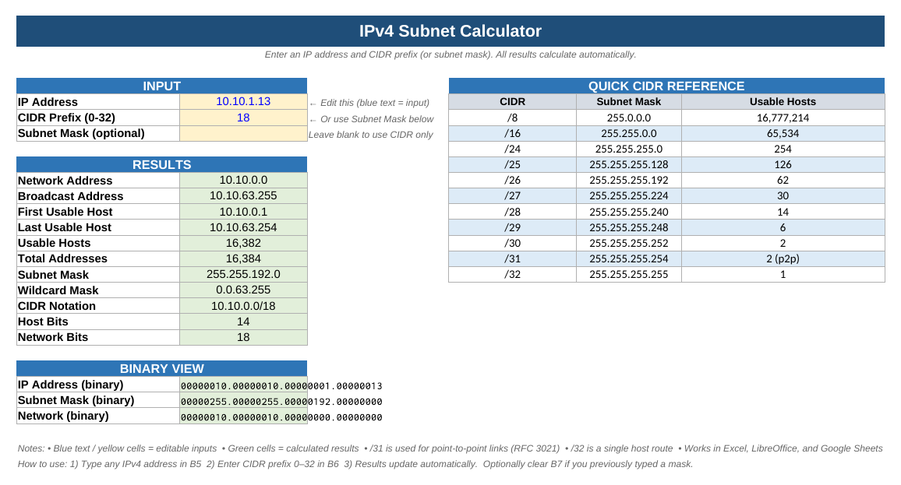

# Excel IPv4 Subnet Calculator

A spreadsheet subnet calculator I designed and built myself in Excel. Type an IPv4 address and a CIDR prefix,
and the sheet works out the network, broadcast, usable host range, host counts, subnet and wildcard masks, using
nothing but worksheet formulas (no macros, no VBA).

This is a separate project from the Python [`subnet-calculator/`](../subnet-calculator/) tool in this repo. I
built the workbook on my own to practice the subnetting math by hand: every result is derived step by step in
visible helper cells, so you can follow exactly how each number is calculated.



*Rendered in LibreOffice Calc with the default input 10.10.1.13/18.*

## What's in the workbook

[`IPv4_Subnet_Calculator.xlsx`](IPv4_Subnet_Calculator.xlsx) has three sheets:

| Sheet | Contents |
|---|---|
| **Subnet Calculator** | The calculator: inputs, results, a binary view block and a quick CIDR reference table (/8 through /32) |
| **Python Script** | A companion script using Python's `ipaddress` module that prints the same results from the command line, handy for checking the spreadsheet's answers |
| **Instructions** | How to use both, plus example inputs to try |

Results on the calculator sheet:

- Network address and broadcast address
- First and last usable host
- Usable hosts and total addresses
- Subnet mask and wildcard mask (the inverse mask used in Cisco ACLs and OSPF)
- CIDR notation, host bits and network bits
- `/31` (point-to-point links, RFC 3021) and `/32` (single host route) are handled as special cases

## How to use it

1. Download [`IPv4_Subnet_Calculator.xlsx`](IPv4_Subnet_Calculator.xlsx) (on GitHub, open the file and click
   **Download raw file**).
2. Open it in any of these:
   - **Microsoft Excel** (desktop or Excel for the web)
   - **LibreOffice Calc** (free, Windows/macOS/Linux)
   - **Google Sheets**: in Google Drive choose **New → File upload**, then open the file with Google Sheets
3. On the **Subnet Calculator** sheet, type an IPv4 address in **B5** (for example `192.168.1.10`).
4. Type the CIDR prefix length (0–32) in **B6** (for example `24`).
5. Everything in the green **Results** cells updates automatically. Only edit the yellow input cells; the helper
   columns H–M hold the intermediate math.

## How it works

The workbook does the same math you do when subnetting on paper, just with spreadsheet formulas. The key idea
is to treat an IPv4 address as one 32-bit number, because then "find the network" becomes simple arithmetic.

### 1. Split the IP into four octets (H5:K5)

The address in B5 is text like `10.10.1.13`. `FIND(".", B5)` locates the first dot, and nesting `FIND` with a
start position finds the second and third dots. `LEFT`, `MID` and `RIGHT` then cut out the text between the dots
and `VALUE` turns each piece into a number:

```text
H5 = VALUE(LEFT(B5, FIND(".",B5)-1))                      → 10   (1st octet)
I5 = VALUE(MID(B5, <after 1st dot>, <length to 2nd dot>))  → 10   (2nd octet)
J5 = VALUE(MID(B5, <after 2nd dot>, <length to 3rd dot>))  → 1    (3rd octet)
K5 = VALUE(RIGHT(B5, <characters after 3rd dot>))          → 13   (4th octet)
```

Each formula is wrapped in `IFERROR(..., 0)` so a half-typed address doesn't fill the sheet with errors.

### 2. Convert the IP to a 32-bit integer (L5)

Each octet is 8 bits, so each one is worth 256 times the octet to its right. Multiplying by the place value
(2²⁴, 2¹⁶, 2⁸, 2⁰) and adding gives the whole address as a single number:

```text
L5 = H5*16777216 + I5*65536 + J5*256 + K5
```

### 3. Build the subnet mask octet by octet (H6:K6)

The prefix (M5) says how many leading bits are network bits. Each mask octet is either all ones (255), all zeros
(0), or partly filled. A partly filled octet with *n* network bits equals `256 - 2^(8-n)`:

```text
H6 = IF(prefix>=8,  255, IF(prefix<=0,  0, 256 - 2^(8-prefix)))
I6 = IF(prefix>=16, 255, IF(prefix<=8,  0, 256 - 2^(16-prefix)))
J6 = IF(prefix>=24, 255, IF(prefix<=16, 0, 256 - 2^(24-prefix)))
K6 = IF(prefix>=32, 255, IF(prefix<=24, 0, 256 - 2^(32-prefix)))
```

The wildcard mask (H8:K8) is each mask octet subtracted from 255.

### 4. Find the network address (L7)

A subnet with *h* host bits is a block of 2ʰ addresses, and every block starts on a multiple of its size. Dividing
the IP integer by the block size, dropping the remainder with `INT`, and multiplying back rounds the address down
to the start of its block. That's the same thing as AND-ing the IP with the mask, without needing bitwise functions:

```text
block size = 2^(32 - prefix)
L7 (network)   = INT(L5 / block size) * block size
L9 (broadcast) = network + block size - 1
```

### 5. Host range and counts (L10, L11, B14, B15)

- **First usable host** = network + 1, **last usable host** = broadcast − 1
- **Total addresses** = 2^(32 − prefix); **usable hosts** = total − 2 (the network and broadcast addresses can't be
  assigned to hosts)
- **Special cases:** a `/31` has 2 usable addresses and no broadcast (RFC 3021 point-to-point links), and a `/32`
  is a single host

### 6. Turn integers back into dotted decimal (B10:B13)

To display a 32-bit integer as an address, the sheet peels off one octet at a time with `INT` (whole division)
and `MOD` (remainder):

```text
INT(n/16777216) & "." & INT(MOD(n,16777216)/65536) & "." & INT(MOD(n,65536)/256) & "." & MOD(n,256)
```

## Worked example: 10.10.1.13/18

This is the default input in the workbook. Values checked against Python's `ipaddress` module.

| Step | Calculation | Result |
|---|---|---|
| Octets | 10 . 10 . 1 . 13 | |
| IP as integer | 10×16,777,216 + 10×65,536 + 1×256 + 13 | 168,427,789 |
| Host bits | 32 − 18 | 14 |
| Block size | 2¹⁴ | 16,384 |
| Network | INT(168,427,789 ÷ 16,384) × 16,384 = 10,280 × 16,384 | 168,427,520 → **10.10.0.0** |
| Broadcast | 168,427,520 + 16,384 − 1 | 168,443,903 → **10.10.63.255** |
| Subnet mask | 3rd octet has 2 network bits: 256 − 2⁶ = 192 | **255.255.192.0** |
| Wildcard mask | 255 − each mask octet | **0.0.63.255** |
| First usable host | network + 1 | **10.10.0.1** |
| Last usable host | broadcast − 1 | **10.10.63.254** |
| Total addresses | 2¹⁴ | **16,384** |
| Usable hosts | 16,384 − 2 | **16,382** |

Same check in Python:

```python
>>> import ipaddress
>>> net = ipaddress.ip_network("10.10.1.13/18", strict=False)
>>> net.network_address, net.broadcast_address, net.netmask, net.hostmask
(IPv4Address('10.10.0.0'), IPv4Address('10.10.63.255'), IPv4Address('255.255.192.0'), IPv4Address('0.0.63.255'))
>>> net.num_addresses, net.num_addresses - 2
(16384, 16382)
```

## Planned improvements

- Show true binary in the **Binary View** block (`DEC2BIN(octet, 8)` instead of zero-padded decimal)
- Use the optional **Subnet Mask** input (B7) when it's filled in; today the prefix in B6 always drives the math
- Flag invalid input (octets over 255, a prefix outside 0–32) instead of calculating silently
